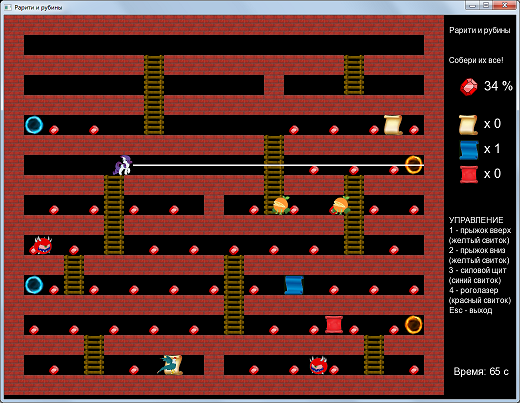

Pacman-style protype of pony arcade game

Прототип аркадной игры про пони в стиле Пакмена

Проект задумывался как изучение создания игр в связке C++, Qt и SFML,
реализован успешно. Для сборки нужно открыть проект `PonyStairs.pro` и
собрать его в QtCreator. Исполняемый файл размещается в каталоге `bin`\
Библиотеки SFML 2.5 уже включены в проект.\
Сборка испытана на Qt 5.14.1.

Дальнейшее развитие концепции игры делалось уже на других движках, например,
в проектах [Трикси и алмазы](https://github.com/tereshenkovav/TrixieDiamonds32)
или [Пони и лабиринт рубинов](https://github.com/tereshenkovav/PonyRubyGrabber)

Этот же проект закрыт как завершенный в учебных целях.
